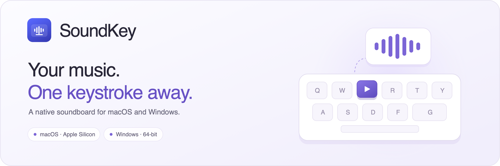
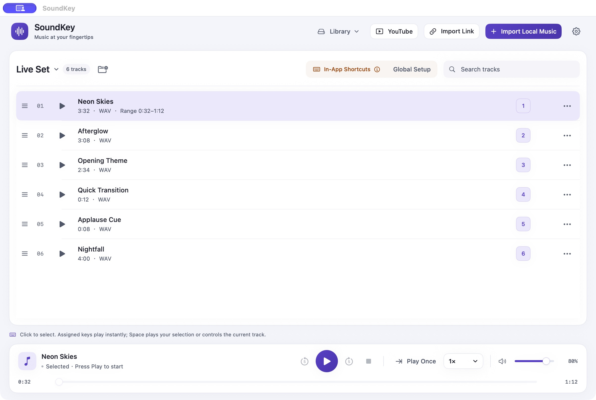
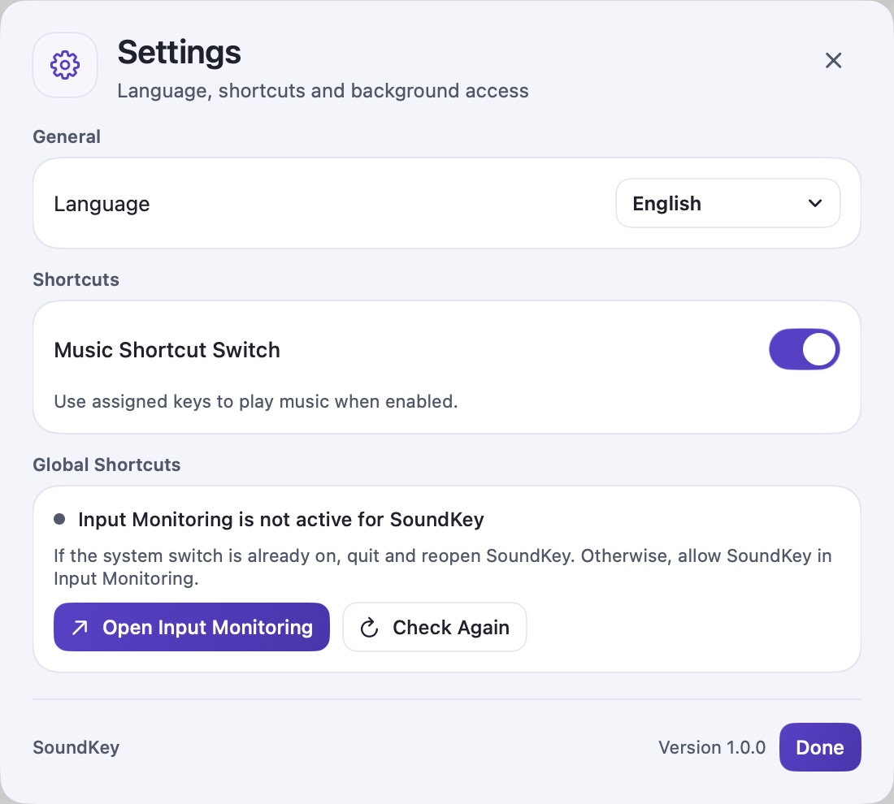

  

  <strong>English</strong> · <a href="README.zh-CN.md">简体中文</a>

  A native music and sound cue player for macOS and Windows. 
  Build your library, assign a key, and keep your next cue within reach.

  <a href="https://github.com/1363306384/SoundKey/releases/latest"><strong>Download SoundKey</strong></a> ·
  <a href="docs/user-guide.md">User guide</a> ·
  <a href="docs/installation.md">Installation</a> ·
  <a href="https://github.com/1363306384/SoundKey/issues">Feedback</a>

## Meet SoundKey

SoundKey keeps music, transitions, and short sound cues in a focused desktop library. Use it for live streams, rehearsals, presentations, or your own listening setup. Organize tracks into groups, set the part you want to play, and trigger a track with its assigned keyboard shortcut.

*macOS interface with fictional sample tracks. Demo audio is not included in the download. The Windows app uses a corresponding native interface.*

## Download 1.0.0

| Platform | Requirements | Installer |
| --- | --- | --- |
| macOS | Apple Silicon · macOS 13 or later | [Download .dmg](https://github.com/1363306384/SoundKey/releases/download/v1.0.0/SoundKey-1.0.0-Mac-arm64.dmg) |
| Windows | Windows 10 or later · x64 | [Download Setup.exe](https://github.com/1363306384/SoundKey/releases/download/v1.0.0/SoundKey-1.0.0-windows-x64-Setup.exe) |

**Current signing status:** the Mac app has a development signature and is **not notarized**; the Windows installer is **unsigned**. Manual system approval may be required. See the [installation guide](docs/installation.md) before installing on another computer.

On Mac, open the disk image, run **安装SoundKey.command**, type **INSTALL**, and finish the macOS Installer. The helper is part of this release's installation flow; its purpose and the fallback steps are documented in the guide. Open the installed app from **Applications**.

On Windows, quit any running copy of SoundKey and run **Setup.exe**.

[Release notes](docs/releases/1.0.0.md) · [SHA-256 checksums](https://github.com/1363306384/SoundKey/releases/download/v1.0.0/SHA256SUMS.txt)

## A small set of useful controls

| Feature | What you can do |
| --- | --- |
| Keyboard cues | Assign a key or key combination to each track. Pause all music shortcuts with one switch. |
| Groups | Keep different sets together, with their own order and shortcut assignments. |
| Local imports | Import MP3, M4A, WAV, and other supported audio files. SoundKey saves a library copy. |
| Playback ranges | Set a start and end point for a track without editing the original recording. |
| Playback controls | Seek, adjust master volume, choose a speed, and play once or repeat a track or list. |
| Online discovery | Search YouTube, preview the original page in your browser, or import a supported link. |
| Library recovery | Export and restore library backups, or recover tracks from Recently Deleted. |
| Two languages | Switch between English and 简体中文 in Settings. |

Online imports need an internet connection and depend on the source site's availability. Use content you have permission to download. Login, subscription, DRM-protected, and other restricted content are not supported.

## Your first cue

1. Choose **Import Local Music** and select an audio file.
2. Click a track to select it, then press **Play**. In the main window, **Space** plays your selection or pauses/resumes the current track.
3. Choose **Set Shortcut** on a track and record the key you want to use.
4. For shortcuts while using another app on Mac, open **Settings → Global Shortcuts** and complete **Input Monitoring** setup. Quit and reopen SoundKey if macOS requests it.

Music still plays with the mouse when music shortcuts are paused. The app distinguishes in-window shortcuts from global access; the system's permission switch alone does not confirm that the running listener is ready.

## English or Chinese

The app starts in English. Open **Settings → Language → 中文** to switch immediately. To read these docs in Chinese, choose **简体中文** at the top of any guide.

## Help and feedback

Start with the [user guide](docs/user-guide.md) and [installation troubleshooting](docs/installation.md). If you still need help, [open an issue](https://github.com/1363306384/SoundKey/issues/new/choose) with your OS version, chip/architecture, SoundKey version, and steps to reproduce. English and Chinese reports are welcome. Remove personal information from screenshots and logs before posting.

The 1.0.0 Mac build passed 24 local regression suites and native UI checks. The Windows build and installer integrity checks passed; native Windows installation, audio, and keyboard-hook testing remain outstanding. The target Mac's first Input Monitoring grant/relaunch flow also remains to be verified.

## About this repository

This repository contains product documentation, images, and downloadable releases. **SoundKey application source code is not published here.** Third-party components keep their respective licenses; see [Third-party notices](docs/third-party-notices.md).
