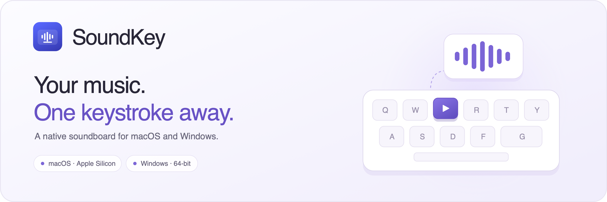
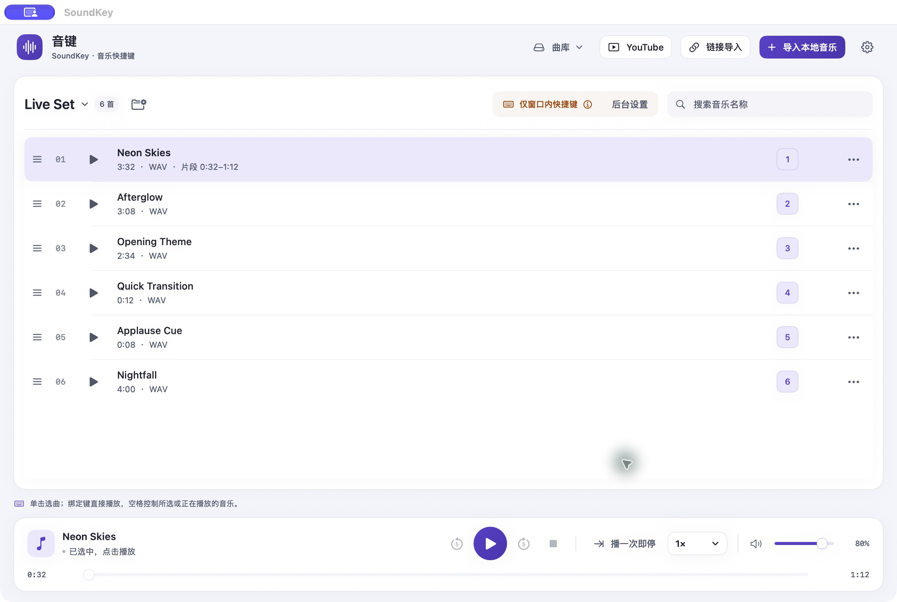
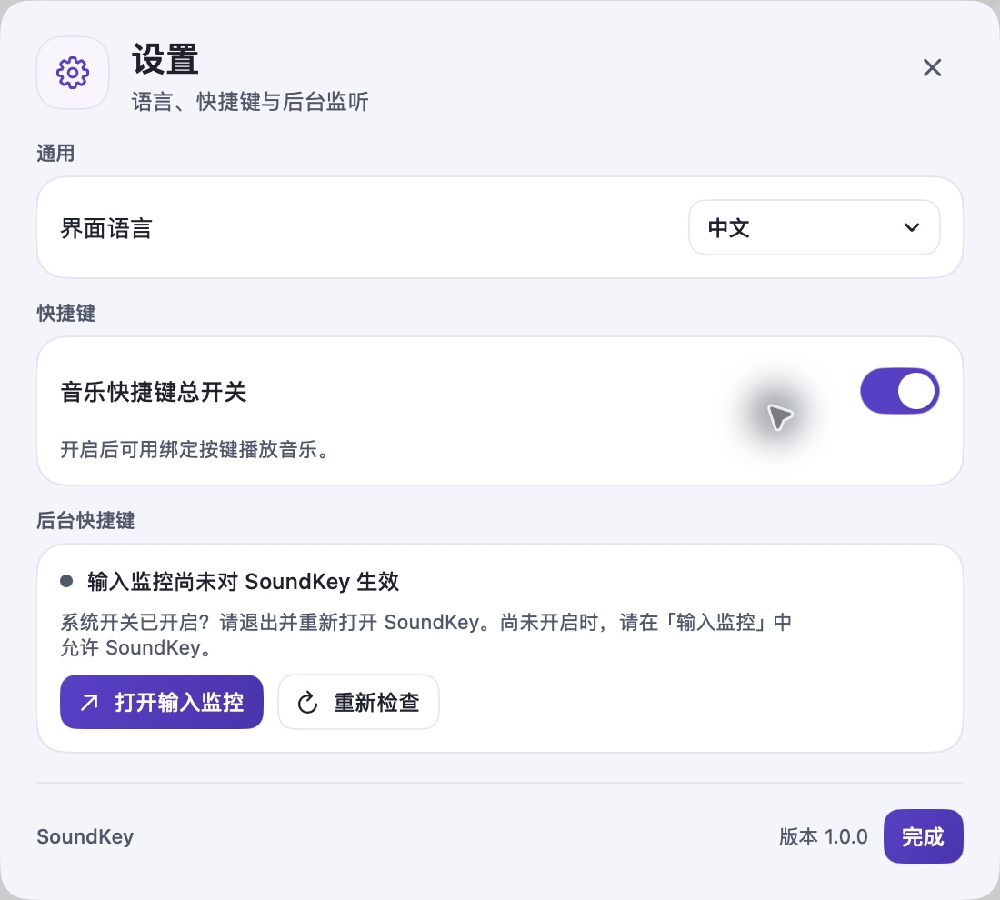

  

  <a href="README.md">English</a> · <strong>简体中文</strong>

  面向 macOS 和 Windows 的原生音乐与音效播放器。 
  整理曲库、绑定按键，让下一段音乐随时就绪。

  <a href="https://github.com/1363306384/SoundKey/releases/latest"><strong>下载 SoundKey</strong></a> ·
  <a href="docs/user-guide.zh-CN.md">使用指南</a> ·
  <a href="docs/installation.zh-CN.md">安装指南</a> ·
  <a href="https://github.com/1363306384/SoundKey/issues">问题反馈</a>

## 认识 SoundKey

SoundKey 把音乐、转场和简短音效集中到一个清晰的桌面曲库中，适合直播、排练、演示和日常播放。按场景整理分组，为音乐设置播放片段，再用绑定按键快速触发。

*图片为 macOS 界面，使用虚构的示例曲目；安装包不附带示例音频。Windows 版采用相同的内容布局与使用流程，文字和窗口控件保留 Windows 原生表现。*

## 下载 1.0.2

| 平台 | 系统要求 | 安装包 |
| --- | --- | --- |
| macOS | Apple Silicon（M 系列）· macOS 13 及以上 | [下载 .dmg](https://github.com/1363306384/SoundKey/releases/download/v1.0.2/SoundKey-1.0.2-Mac-arm64.dmg) |
| Windows | Windows 10 及以上 · x64 | [下载 Setup.exe](https://github.com/1363306384/SoundKey/releases/download/v1.0.2/SoundKey-1.0.2-windows-x64-Setup.exe) |

<strong>当前签名状态：</strong>Mac 应用使用开发签名，**尚未公证**；Windows 安装包**未签名**。安装时可能需要手动允许，请先阅读[安装指南](docs/installation.zh-CN.md)。

Mac：打开磁盘映像，运行包内 **Install SoundKey.command**，输入 **INSTALL**，再完成系统安装器中的步骤。这个文件属于当前版本的安装流程，作用和备用操作见安装指南。安装后从「应用程序」打开 SoundKey。

Windows：先退出正在运行的 SoundKey，再运行 **Setup.exe**。安装与卸载向导使用英文，应用内仍可切换英文和中文。

[版本说明](docs/releases/1.0.2.zh-CN.md) · [SHA-256 校验文件](https://github.com/1363306384/SoundKey/releases/download/v1.0.2/SHA256SUMS.txt)

## 常用功能

| 功能 | 可以做什么 |
| --- | --- |
| 按键播放 | 给音乐绑定按键，设置暂停／继续键（默认 M），总开关可暂停全部音乐快捷键。 |
| 曲库分组 | 按使用场景保存音乐、曲目顺序和按键绑定。 |
| 本地导入 | 后台导入支持的音频格式，显示进度，提供重复选择与整批取消，并保存曲库副本。 |
| 本地 MP4 转 MP3 | 离线提取音频，保存为 192 kbps MP3，可自行选择保存位置。 |
| 播放片段 | 设置音乐的起点与终点，无需修改原始录音。 |
| 播放控制 | 拖动进度、调整总音量和速度，支持播一次即停、单曲循环与列表循环。 |
| 在线查找 | 搜索 YouTube，在浏览器试听原页面，或导入支持的链接。 |
| 备份与恢复 | 导出、恢复曲库备份，从「最近删除」找回移除的音乐。 |
| 双语界面 | 在设置中即时切换 English 与简体中文。 |

在线导入需要网络，能否下载取决于来源网站。请仅下载你有权使用的内容；需要登录、订阅或受 DRM 等限制的内容不受支持。

## 开始播放

1. 点击「导入本地音乐」，选择音频文件。
2. 单击音乐选中，再点击「播放」。主窗口中的空格键可播放所选音乐，或暂停、继续当前音乐。
3. 点击一首音乐的「设置快捷键」，录入希望使用的按键。
4. Mac 上需要在其他软件中触发快捷键时，打开「设置 → 后台快捷键」，完成「输入监控」授权。系统要求时，请退出并重新打开 SoundKey。

暂停音乐快捷键后，仍可用鼠标播放。应用会区分窗口内快捷键和后台监听状态；系统开关打开，并不表示当前运行进程的监听已经生效。

## 切换语言

应用默认使用英文。打开 **Settings → Language → 中文** 即可即时切换。本仓库文档默认英文，每篇指南顶部都可点击「简体中文」。

## 使用帮助与反馈

先查看[使用指南](docs/user-guide.zh-CN.md)和[安装问题排查](docs/installation.zh-CN.md)。仍有问题时，可[提交 Issue](https://github.com/1363306384/SoundKey/issues/new/choose)，说明系统版本、芯片或架构、SoundKey 版本及复现步骤。欢迎使用中文或英文反馈，发布截图和日志前请移除个人信息。

SoundKey 1.0.2 在两端增加后台批量导入、可设置的暂停／继续快捷键和本地 MP4 转换，并以 Mac 为基准对齐 Windows 布局及对话框流程。系统窗口控件、字体、文件选择器、按键名称与权限设置保留各平台行为。自动检查与包体审计范围见[版本说明](docs/releases/1.0.2.zh-CN.md)；本次候选版的 Windows 原生实机验证，以及另一台 Mac 首次输入监控授权后的退出与重开流程仍未完成。

## 关于本仓库

这里提供产品介绍、图片、使用文档及安装包。<strong>不公开 SoundKey 程序源码。</strong>第三方组件遵循各自许可证，详见[第三方声明](docs/third-party-notices.md)。
